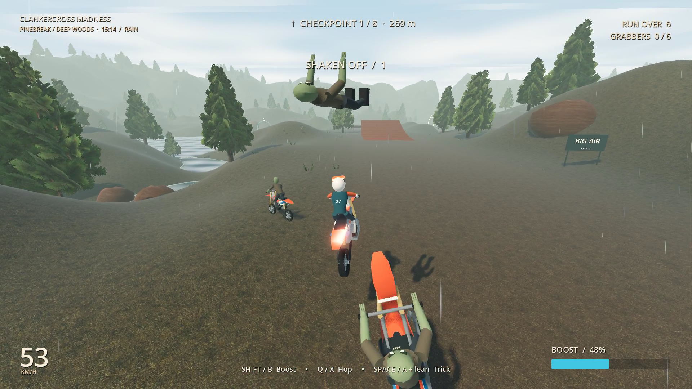

# Clankercross Madness

A Windows motocross game with three open riding worlds, six race courses, CPU opponents, a physics playground, and a zombie escape mode.

## Download

[Get the latest Windows release](https://github.com/n30nex/Clankercross-Madness/releases/latest). Extract the ZIP and run **ClankercrossMadness.exe**. The game is single-player and works offline.

## New in 0.3.0

- Two marked circuits in each world, with five CPU rivals and three difficulty settings.
- Three-lap races, a starting grid and countdown, live position and lap times, ordered gates, and results.
- Solo time trials, local personal bests, and a route map.
- Generated race-dirt material, waving track flags, cheering spectators, rival engine sounds and dust, tire trails, and forest fireflies after dark.
- Moving handlebars and forks, rider crouch and lean animation, and improved recovery and zombie navigation.

| World | Courses |
|---|---|
| Redstone Badlands | Redstone MX · Mesa Run |
| Pinebreak Forest | Timberline MX · Cedar Circuit |
| Frostbite Highlands | Snowcap MX · Glacier Run |

Select **Race & Time Trial** after choosing a world. In a race, **R / Y** rejoins the last passed gate with a five-second wait. Time Trial is a single lap. Best times stay on your PC. **Free Ride This Track** starts sandbox play on the selected course.

## Ride your way

- **Redstone Badlands:** sandstone quarry, big-air jumps, desert trails and flooded dig sites.
- **Pinebreak Forest:** pine woods, muddy trails, a winding river and shallow crossings.
- **Frostbite Highlands:** snowy slopes, icy ground and open alpine water.
- Weather can be automatic or set to clear, rain, thunderstorm or snow. A 12-minute day/night cycle changes the light, and the bike's headlight brightens after dark.

**Sandbox** has unlimited nitrous, gravity and tire-grip sliders, super hops, pinball landings, and rider ejection. Try moon gravity, zero-G boost flight, or ice-like grip. Shallow water slows the bike; deep water sends you off it. Recover whenever you need to keep exploring.

**Zombie Escape** sends foot zombies and motorcycle riders after you. Pass seven checkpoint gates and the finish gate. Run enemies over to increase the counter. Grabbers slow your bike; jumps and high speed shake them off. Six attached zombies end the run. The horde replenishes and grows as checkpoints are cleared. Boost and hops share a rechargeable reserve in this mode.

## Controls

| Action | Keyboard / mouse | Xbox-style controller |
|---|---|---|
| Throttle / brake | W / S | RT / LT |
| Steer | A / D | Left stick |
| Lean / air control | Arrow keys | Right stick |
| Trick modifier | Space | A |
| Nitrous | Shift | B |
| Hop | Q | X |
| Recover / remount | R | Y |
| Look around | Right mouse, or C + arrows | RB + right stick |
| Eject rider in sandbox | V | LB |
| Pause | Escape | Start |

Controls can be rebound in the game. In Zombie Escape, recovery is available after a riding wipeout, but it does not remove attached zombies. Deep water or an overrun ends the attempt.

## About this repository

This is a **downloads and documentation repository**. The editable game project and game source are not published here. GitHub's automatically generated repository archives contain these distribution documents only.

Credits and third-party notices are included with the Windows download. See the release's validation notes for the tested hardware and results.
